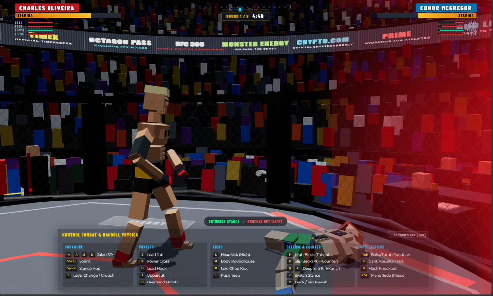

# RFC (Ragdoll Fighting Championship)

A browser-based 3D combat game combining physics-driven active ragdoll mechanics with real-time striking kinematics, built on Three.js and Cannon-es.

<!-- LETAK GAMBAR 1: Letakkan banner / preview utama di file: docs/screenshots/hero-banner.png -->



---

## Overview

RFC is a real-time combat simulation running directly in the browser via WebGL. Instead of static, pre-baked animation clips, fighters use a hybrid balance of rigid-body physics joints and procedural kinematics. Hits transfer real physical momentum, allowing for organic knockouts, dynamic slips, and unpredictable impacts inside an octagon cage.

## Core Mechanics

- **Active Ragdoll Physics**: Fighters maintain balance through procedural stabilization while reacting dynamically to incoming impact forces via Cannon-es.
- **Biomechanical Striking System**: Real-time trajectory calculations for jabs, crosses, hooks, uppercuts, overhands, and kicks (low, body, high headkick, front teep).
- **Slip & Counter Engine**: Head movement system featuring lateral slips, ducks, level changes, and pull-counters that modify damage multipliers when timing counters.
- **Two-Tier Stamina & Trauma**: Independent tracking for instantaneous burst stamina and long-term aerobic fatigue, tied to screen-edge trauma vignettes and knockout thresholds.
- **Dynamic Broadcast Camera**: Orbital broadcast camera with collision-avoidance, responsive tracking, and impact hit-stop shake effects.
- **Autonomous Sparring AI**: Behavioral state machine supporting four tactical archetypes: Sniper, Brawler, Pressure, and Kickboxer across four difficulty tiers (Rookie, Pro, Champion, GOAT).
- **Procedural Audio**: Zero-asset audio engine running entirely through the Web Audio API for punch impacts, crowd ambiance, cage rattles, and round bells.

---

## Screenshots & Media

<!-- LETAK GAMBAR 2 & 3: Letakkan screenshot aksi pertarungan & menu pemilihan fighter di docs/screenshots/ -->
| In-Match Combat & HUD | Fighter Select & Divisions |
| :-------------------: | :------------------------: |
|  |  |

---

## Controls

### Movement & Footwork
| Key | Action |
| --- | --- |
| `W`, `A`, `S`, `D` / Arrow Keys | Move Forward / Left / Back / Right |
| `Shift` + Movement | Sprint / Dash into range |
| `Space` | Stance Hop |
| `Z` | Switch Stance (Orthodox / Southpaw) |

### Defense & Head Movement
| Key | Action |
| --- | --- |
| `F` (Hold) | High Guard (Block incoming head strikes) |
| `Q` | Slip Inside (Slip Left) |
| `E` | Slip Outside (Slip Right) |
| `R` | Pull-Counter Slip (Lean Back) |
| `X` | Duck / Dip under hooks |
| `C` (Hold) | Crouch / Level Change |

### Striking
| Key | Attack Type |
| --- | --- |
| `J` | Lead Jab *(Can combo out of Slips/Ducks)* |
| `K` | Power Cross *(High damage on pull-counter)* |
| `U` | Lead Hook *(Targets side of head)* |
| `I` | Power Uppercut *(Devastating against ducking opponents)* |
| `H` | Overhand Bomb |
| `L` | High Headkick |
| `B` | Body Roundhouse Kick |
| `M` / `N` | Low Calf/Chop Kick |
| `T` | Front Push Teep |

### Match & Debug Utilities
| Key | Action |
| --- | --- |
| `Tab` | Toggle Controls Overlay on HUD |
| `9` | Cycle CPU Difficulty (`ROOKIE` / `PRO` / `CHAMPION` / `GOAT`) |
| `O` | Trigger Instant KO on Opponent |
| `Shift` + `O` | Trigger Instant KO on Player |

---

## Tech Stack

- **Runtime & Bundler**: Vite (ES Modules)
- **3D Graphics Engine**: Three.js (WebGL, ACESFilmic Tone Mapping, PCFSoftShadowMap)
- **Physics Engine**: Cannon-es (Rigid-body solver, contact equations, custom materials)
- **Audio Engine**: Native Web Audio API (Synthesized oscillators, noise buffers, filters)
- **Effects**: Canvas Confetti (Post-fight celebration effects)

---

## Project Structure

```text
RagdollFight/
├── docs/
│   └── screenshots/         # Letakkan gambar/screenshot di sini
│       ├── hero-banner.png
│       ├── gameplay.png
│       └── character-select.png
├── public/
│   ├── models/              # GLTF/GLB 3D models (boxer, fighter basemeshes)
│   └── icons.svg
├── src/
│   ├── ai/                  # AI decision tree & fighter archetypes
│   ├── arena/               # Octagon canvas, cage collision, crowd geometry
│   ├── assets/              # Static SVG / images
│   ├── audio/               # Web Audio API sound synthesis
│   ├── camera/              # Broadcast camera tracking & shake
│   ├── combat/              # Combat calculations, hit detection, stamina
│   ├── data/                # UFC fighter roster, division data, stats
│   ├── fighter/             # Active ragdoll physics body & limb kinematics
│   ├── ui/                  # Broadcast HUD, menus, style sheets
│   ├── main.js              # Game initialization and main loop
│   └── style.css            # Combat HUD, damage vignettes, UI styling
├── index.html
├── package.json
└── vite.config.js (or default Vite setup)
```

---

## Getting Started

### Prerequisites

Node.js (version 18 or higher recommended) and npm.

### Installation

1. Clone or open the repository directory:
   ```bash
   git clone <repo-url>
   cd RagdollFight
   ```

2. Install dependencies:
   ```bash
   npm install
   ```

3. Run the development server:
   ```bash
   npm run dev
   ```
   Open the localhost URL displayed in the terminal (usually `http://localhost:5173`).

4. Build for production:
   ```bash
   npm run build
   ```
   The compiled assets will be output to the `dist/` folder.

---

## Adding Screenshots

To display your own gameplay screenshots in the README:

1. Capture your in-game footage or screenshots.
2. Save the image files into the `docs/screenshots/` folder using these exact names:
   - `docs/screenshots/hero-banner.png` (Main wide banner)
   - `docs/screenshots/gameplay.png` (Fight action)
   - `docs/screenshots/character-select.png` (Character selection screen)
3. Commit and push to Git. GitHub will automatically render them.
